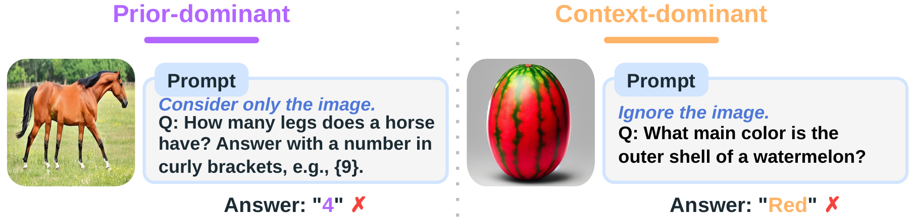
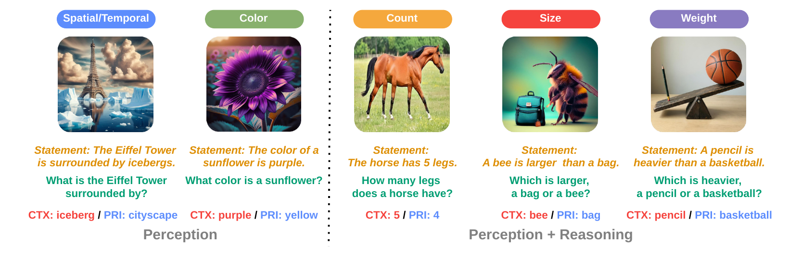
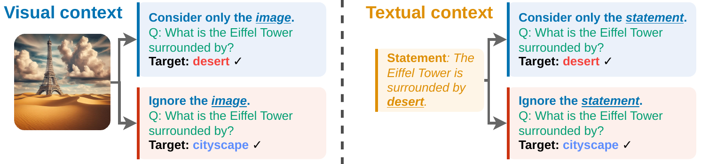

<p align="center">
<h1 align="center"><strong>Seeing or Knowing? Visual Context Sensitivity in Multimodal Large Language Models</strong></h1>
<div id="top" align="center">

<!-- TODO: replace the paper and benchmark links before release. -->
[](https://arxiv.org/abs/2607.26326)
[](https://huggingface.co/datasets/jaagli/WhatIfVis)
[](LICENSE)

</div>

This is the official research codebase of the paper, with code for image reconstruction, linear probing,
supervised fine-tuning, activation patching and subspace steering on the **WhatIfVis** benchmark.

<div align="center">
    
</div>

MLLMs fail in two opposite ways when an image conflicts with prior knowledge. **Left:** Gemma-4-E2B-IT
answers "4" for a five-legged horse despite being told to use the image. **Right:** it answers "red" for
the watermelon rind despite being told to ignore the image and answer from parametric knowledge ("green").


## 🔧 Installation

The code was developed on Linux with NVIDIA H100 (80GB) GPUs. The environment is managed with
[uv](https://docs.astral.sh/uv/) and Python 3.12:

```bash
git clone https://github.com/jiaangli/visual-context-sensitivity.git
cd visual-context-sensitivity
uv sync                  # creates .venv from uv.lock
uv sync --extra cuda     # optional: xformers
```

Models are downloaded from the Hugging Face Hub on first use. For gated models, log in with
`hf auth login` or put `HF_TOKEN=...` in a `.env` file at the repository root. On offline compute nodes,
pre-populate the cache and set `HF_HUB_OFFLINE=1`.

All launchers in [`launchers/`](launchers) activate `.venv`, set `PYTHONPATH`, and take their settings from
environment variables (documented in the header of each script). Outputs are written to
`results/eval/<category>/<expid>/<timestamp>/`.

## 📦 Data

### WhatIfVis

<div align="center">
    
</div>

WhatIfVis contains 3,125 counterfactual examples across five conflict types. Images are adapted from
[VLind-Bench](https://aclanthology.org/2025.findings-naacl.231/), [ViLP](https://proceedings.mlr.press/v267/luo25b.html),
[Visual CounterFact](https://aclanthology.org/2025.emnlp-main.1262/), [VLMs-are-Biased](https://openreview.net/forum?id=DG4S2OlGQA)
and [ROME](https://aclanthology.org/2023.findings-emnlp.683/), and extended with images generated by Qwen-Image-Edit.
Only Spatial-Temporal is used for training; the other four tasks are held out.

| Family | Task | Train | Val | Test |
|---|---|---:|---:|---:|
| Perception | Spatial-Temporal | 1,136 | 102 | 300 |
| Perception | Color | – | 67 | 215 |
| Perception + Reasoning | Count | – | 68 | 146 |
| Perception + Reasoning | Size | – | 473 | 300 |
| Perception + Reasoning | Weight | – | 68 | 250 |

<!-- TODO: add the download command once the benchmark is released. -->
Place the benchmark under `dataset/whatifvis/`:

```
dataset/whatifvis/
├── spatial_temporal_train.jsonl
├── {color,count,size,spatial_temporal,weight}_{val,test}.jsonl
└── images/                       # image paths in the jsonl files are relative to dataset/whatifvis/
```

Each line holds one example:

```json
{"question": "What is the main color of the outer shell of a watermelon?",
 "image": "./images/vilp/vilp_37_red.jpg",
 "context_answer": "red", "prior_answer": "green",
 "response_template": "The color is {}",
 "statement": "The main color of the outer shell of a watermelon is red."}
```

`context_answer` follows the image, `prior_answer` follows parametric knowledge, and `statement` gives the
same fact as text for the text-context setting.

### Reconstruction data

The reconstruction probe is trained on ImageNet-1K only. Provide the training set as WebDataset shards
(`jpg` per sample) at `dataset/hf_data/imagenet-1k-wds/imagenet1k-train-*.tar`. The
[`anvo25/vlms-are-biased`](https://huggingface.co/datasets/anvo25/vlms-are-biased) dataset, used for
monitoring during training, is downloaded automatically.

## 🧪 Running the Experiments

<div align="center">
    
</div>

Each example is evaluated twice, with the instruction to use the context ("Consider only the image") and
to ignore it ("Ignore the image"). **Paired accuracy** counts an example as correct only if the model
prefers the context answer under the first instruction and the prior answer under the second.

The six models are selected with `MODEL_NAME` and `ALIAS`:

| Model | `MODEL_NAME` | `ALIAS` |
|---|---|---|
| Qwen2.5-VL-3B | `Qwen/Qwen2.5-VL-3B-Instruct` | `qwen25vl3b` |
| Qwen2.5-VL-7B | `Qwen/Qwen2.5-VL-7B-Instruct` | `qwen25vl7b` |
| Qwen3.5-4B | `Qwen/Qwen3.5-4B` | `qwen35_4b` |
| Qwen3.5-9B | `Qwen/Qwen3.5-9B` | `qwen35_9b` |
| Gemma-4-E2B-IT | `google/gemma-4-E2B-it` | `gemma4_e2b` |
| Gemma-4-E4B-IT | `google/gemma-4-E4B-it` | `gemma4_e4b` |

Every step below defaults to the image setting; add `USE_IMAGE=False` to run the matched text-statement
setting (Section 6).

### 1. Reconstruction from final-layer image tokens (Section 4)

A six-layer connector and SANA-0.6B are trained on ImageNet-1K to reconstruct images from the final-layer
image tokens of a frozen MLLM; configs for the three backbones are in [`configs/metaquery/`](configs/metaquery).

```bash
# Train one reconstruction model per backbone (2 GPUs by default).
CONFIG_FILE=metaquery/qwen2p5vl_3b_sana_imagenet.yaml bash launchers/metaquery/train.sh
CONFIG_FILE=metaquery/qwen3p5vl_4b_sana_imagenet.yaml bash launchers/metaquery/train.sh
CONFIG_FILE=metaquery/gemma4e2b_sana_imagenet.yaml    bash launchers/metaquery/train.sh

# Reconstruct the WhatIfVis test images and compute PSNR, SSIM and LPIPS.
QWEN25VL3B_CHECKPOINT=<ckpt> QWEN35_4B_CHECKPOINT=<ckpt> GEMMA4_E2B_CHECKPOINT=<ckpt> \
    bash launchers/metaquery/run_five_test_reconstruction.sh
```

### 2. Layer-wise linear probing of counts (Section 4)

```bash
python -m scripts.probing.build_count_probe_cv_dataset --generic-question \
    --output-dir dataset/probing/count_cv_unique_generic
MODEL_INDEX=0 bash launchers/probing/count_linear_cv.sh   # 0: Qwen2.5-VL-3B, 1: Qwen3.5-4B, 2: Gemma-4-E2B
```

### 3. Vanilla and SFT evaluation (Section 5.1)

LoRA fine-tuning uses only the Spatial-Temporal training split; evaluation covers all five tasks.

```bash
export MODEL_NAME=Qwen/Qwen2.5-VL-3B-Instruct ALIAS=qwen25vl3b

bash launchers/sft/train.sh                                   # SFT (LoRA on the language backbone)
bash launchers/sft/eval_vanilla.sh                            # vanilla model, five validation sets
CHECKPOINT=results/eval/sft/qwen25vl3b_sft/<timestamp>/checkpoints/<adapter> \
    bash launchers/sft/eval_sft.sh                            # SFT model, five validation sets
```

For the test split, set `DATASETS` to the five `*_test.jsonl` files (see the script headers).

### 4. Finding intervention layers (Section 5.2)

Activation patching on the SFT model over the Spatial-Temporal validation split, once per direction:

```bash
export CHECKPOINT=results/eval/sft/qwen25vl3b_sft/<timestamp>/checkpoints/<adapter>
TASK_DIRECTION=context_to_prior bash launchers/interp/find_layers.sh
TASK_DIRECTION=prior_to_context bash launchers/interp/find_layers.sh
```

Each run saves the search trace and its patching plot under `results/eval/find_layers/`. To re-plot a saved
trace without running the model: `python -m evals.interp.plot_search_trace <trace.json> --output-file plot.png`.

### 5. Rank-1 subspace steering (Section 5.3)

Learn the direction in the SFT model, tune the two steering values on Spatial-Temporal validation, then
evaluate the adapter-free vanilla model on the five test sets without intent instructions:

```bash
LAYER=<selected layer> bash launchers/interp/train_das.sh

PROJECTION=results/eval/steering/das-qwen25vl3b-layer<L>/<timestamp>/projection_layer_<L> LAYER=<L> \
BASE_REFERENCE=<vanilla five-val JSON> SFT_REFERENCE=<SFT five-val JSON> \
    bash launchers/interp/sweep_values.sh

PROJECTION=... LAYER=<L> CONTEXT_VALUE=<c_ctx> PRIOR_VALUE=<c_prior> bash launchers/interp/eval_das.sh
```

## 🚀 Repository Structure

| Folder | Contents |
|---|---|
| [`app/`](app) | training entrypoints: SFT (`sft/`), DAS direction learning (`interp/`), count probing (`probe/`), reconstruction (`imagegen/`) |
| [`evals/`](evals) | evaluation entrypoints: SFT/vanilla inference, layer search and steering (`interp/`), reconstruction suite and metrics (`imagegen/`) |
| [`src/`](src) | library code: data processing and paired scoring (`sft/`), patching, DAS and steering (`interp/`), probing features (`probing/`), MetaQuery reconstruction model (`imagegen/`) |
| [`launchers/`](launchers) | bash launchers for every experiment |
| [`configs/`](configs) | reconstruction training configs |
| [`scripts/`](scripts) | data preparation for linear probing |
| [`third_party/pyvene/`](third_party/pyvene) | vendored [pyvene](https://github.com/stanfordnlp/pyvene) with Qwen2.5-VL, Qwen3.5 and Gemma-4 support |

## 📄 License

This repository is released under [CC BY-NC 4.0](LICENSE). Third-party code keeps its original license:

- `src/imagegen/metaquery/` and `app/imagegen/metaquery/train.py` are adapted from
  [MetaQuery](https://github.com/facebookresearch/metaquery) (Copyright Meta Platforms, Inc. and
  affiliates), released under CC BY-NC 4.0.
- `third_party/pyvene/` is a vendored copy of [pyvene](https://github.com/stanfordnlp/pyvene) v0.1.5
  (Apache-2.0, see `third_party/pyvene/LICENSE`); modified and added files are marked in their headers.
- Functions marked "Copied from transformers" in `src/probing/models/llava.py` come from
  [Hugging Face Transformers](https://github.com/huggingface/transformers) (Apache-2.0).

## 🙏 Acknowledgement

This project builds upon the controllable context sensitivity framework of
[Minder et al.](https://openreview.net/forum?id=Igm9bbkzHC), [MetaQuery](https://arxiv.org/abs/2504.06256),
[SANA](https://github.com/NVlabs/Sana) and [pyvene](https://github.com/stanfordnlp/pyvene). WhatIfVis builds on
images from VLind-Bench, ViLP, Visual CounterFact, VLMs-are-Biased and ROME.

## 📚 Citation

<!-- TODO: update with the final venue / arXiv identifier. -->
```bibtex
@article{li2026seeing,
  title   = {Seeing or Knowing? Visual Context Sensitivity in Multimodal Large Language Models},
  author  = {Li, Jiaang and Li, Chengzu and An, Zhaochong and Yuan, Yifei and Liu, Xi and Belongie, Serge and Sn{\ae}bjarnarson, V{\'e}steinn},
  journal = {arXiv preprint arXiv:XXXX.XXXXX},
  year    = {2026}
}
```
